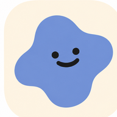

# Blob



Blob is the simplest game. You see a random blob — finish the picture to show what you see in it. 

## How to play

- Draw with the **brush**, fix things with the **eraser** — each has its own size.
- Pick colours from the swatches; the palette changes with every new blob.
- **New blob** (top right) generates a fresh blob, background and palette.
- **Clear** wipes the canvas blank.

## Play on your phone

Open the site in Safari → Share → **Add to Home Screen**. Blob installs as a full-screen app and works offline after the first visit.

## Run locally

Just open `index.html` in a browser, or serve the folder:

```
python3 -m http.server 8123
```

## Tech

One self-contained HTML file — no frameworks, no dependencies, no backend.
